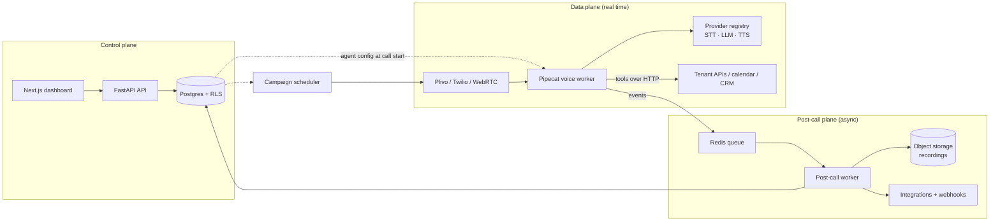
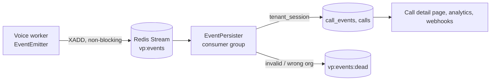

# Architecture

Status: draft (Phase 0). Update this file when the design changes; record the reason in docs/decisions/.

## 1. Big picture

Three planes, connected by Postgres and an event stream:



- **Control plane** stores tenants, agents (versioned config), numbers, campaigns, calls, results.
- **Data plane** handles live audio. A worker loads the agent config for the dialed/dialing number and
  builds a Pipecat pipeline at call start. No tenant-specific code exists.
- **Post-call plane** turns a finished call into data: recording, transcript, summary, extractions,
  dispositions, CRM write-back, outbound webhooks.

## 2. Call lifecycle

1. **Inbound:** telephony webhook → verify provider signature → `resolve_inbound_number(dialed e164)`
   returns the owning `org_id` only → open `tenant_session(org_id)` → load `phone_number → agent_version`
   under RLS → assign a worker → worker connects media stream (decision 0005, "Resolvers").
   **Outbound:** campaign scheduler picks the next eligible contact (window, concurrency, retries,
   compliance) → places call via telephony API → same worker path on answer.
2. Worker builds pipeline from config: VAD/turn detection → STT → LLM (+ tools, Flows state) → TTS.
3. During the call: emit `turn` and `tool_call` events with timings; filler lines for slow tools.
4. Optional `transfer` to a human number.
5. `call.ended` → queue post-call job.
6. Post-call worker: store recording → final transcript → summary → extractions + dispositions
   (with confidence) → low-confidence items to review queue → CRM write-back → signed webhook →
   `extraction.done`.

## 3. Multi-tenancy

Details and rationale: decisions 0002 and 0005.

- Tenant = `organization`. Every tenant-owned row has `org_id`.
- Postgres RLS (ENABLE + FORCE) on every table. Policies compare `org_id` to `app_current_org()`,
  which reads `app.current_org`. `vp_db.session.tenant_session(org_id)` sets it transaction-locally
  at the start of every transaction; with no org set, nothing matches (fail closed).
- Roles: `vp_migrator` owns tables and runs Alembic; `vp_app` (API + workers) is not superuser, not
  owner, NOBYPASSRLS, DML only. Local provisioning: `scripts/db/init.sql`.
- Tenant tables have `UNIQUE (org_id, id)`; FKs between tenant tables are composite
  `(org_id, x_id)` so a row can't reference another org's row. Org FKs are `ON DELETE RESTRICT`.
- **Entering a tenant before the org is known** (inbound calls, third-party webhooks, schedulers):
  authenticate the request, call a narrow `SECURITY DEFINER` resolver that maps one key to an
  `org_id` only (`resolve_inbound_number(e164)`, `resolve_webhook_endpoint(token)`,
  `list_active_org_ids()`), then open a normal `tenant_session`. Resolvers are owned by a NOLOGIN
  BYPASSRLS role `vp_resolver`, pin `search_path`, and are executable only by `vp_app`.
- API auth resolves user → membership → org; workers act with the org of the call.
- Per-tenant settings: provider presets, BYOK keys (encrypted), retention days, PII redaction, calling windows.

## 4. Data model (first cut)

All tenant tables also have `UNIQUE (org_id, id)`, composite FKs and the standard RLS policy.

| Table | Key columns | Notes |
| --- | --- | --- |
| organizations | id, name, region (`in`/`us`/`eu`, default `in`), settings | tenant root; visible only to itself. **Built (migration 0001).** |
| users | id, email (unique, case-insensitive), name | global identity; readable via membership in the current org. **Built.** |
| memberships | id, org_id, user_id, role | owner, admin, member; unique (org_id, user_id). **Built.** |
| agents | id, org_id, name, industry_template | logical agent |
| agent_versions | id, agent_id, version, config_json, resolved_voice, published_at | immutable; calls pin a version; `resolved_voice` = providers resolved at publish (0006) |
| phone_numbers | id, org_id, e164, provider, series, agent_id, status | 140/160 series stored; **e164 globally unique** (one number → one org); resolved by `resolve_inbound_number` |
| contacts | id, org_id, e164, attributes_json, consent, dnd_status | dedupe on (org_id, e164) |
| campaigns | id, org_id, agent_version_id, schedule_json, retry_json, concurrency, status | |
| campaign_contacts | campaign_id, contact_id, row_vars_json, attempts, state, last_outcome | one row per CSV row |
| calls | id, org_id, agent_version_id?, campaign_id?, contact_id?, direction, status, from/to number, started_at, ended_at, ended_by, duration_ms, cost | **Built (migration 0002).** Created by the API before the worker starts; start/end filled from events |
| call_events | id (event id), org_id, call_id, seq, type, v, ts, payload | **Built.** Unique (org_id, call_id, seq); composite FK to calls; written only by the event persister (0007) |
| extraction_fields | id, org_id, agent_id, name, type, question, options, regex | typed definitions |
| call_results | call_id, field_id, value, confidence, reasoning, reviewed_by? | extractions + dispositions |
| integrations | id, org_id, kind, credentials_enc, settings_json | calendar, CRM, n8n |
| webhooks | id, org_id, url, secret, events | signed, retried |
| usage_records | org_id, call_id, minutes, provider_costs_json | metering before billing |

## 5. Agent config (shape)

```json
{
  "language": ["hi-IN", "en-IN"],
  "persona": { "name": "Asha", "prompt": "..." },
  "greeting": "Namaste {name}, ...",
  "flow": { "states": [ { "id": "verify", "next": ["book", "transfer"] } ] },
  "voice": { "preset": "india-standard", "stt": "sarvam", "llm": "gpt", "tts": "sarvam:voice-id" },
  "tools": [ { "name": "check_slots", "type": "calendar", "integration_id": "..." } ],
  "extraction_fields": ["field_id_1", "field_id_2"],
  "transfer": { "number": "+91...", "when": "caller asks for a human" },
  "limits": { "max_call_seconds": 600, "silence_timeout_s": 8 }
}
```

The JSON Schema in `packages/shared/` is authoritative; this is illustrative.

## 6. Provider registry

Decision 0006. Code: `vp_shared.providers` (catalog, presets, resolution; no Pipecat) and
`workers/voice/worker/providers/` (registry, chains, adapters).

```python
resolved = resolve_voice(config["voice"])          # at publish; stored on the agent version
chain = registry.chain("tts", resolved.tts, BuildContext(org_id=..., language="hi-IN"))
built, fallbacks = await chain.build_first()       # primary, else next; fallbacks -> events
built, more = await chain.build_next(built.spec, "error", "websocket closed")  # runtime failover
```

- One adapter per vendor and kind, one file each; only adapters import vendor services.
- Presets resolve to explicit providers at publish; published versions never follow preset edits.
- Every provider has a fallback from another vendor. Phase 1: start-of-call fallback for all kinds,
  per-request LLM fallback. Phase 5: mid-call STT/TTS switching.
- Keys via `CredentialResolver` (platform env keys now; BYOK in Phase 3).
- Adapters report usage units (STT audio-seconds, LLM tokens, TTS characters) in `call.ended`;
  prices are applied separately.

## 6a. Call events

Decision 0007. Schema: `packages/shared/events.schema.json`; examples in
`packages/shared/examples/events/`.



- Envelope `{id, type, v, org_id, call_id, seq, ts, payload}`; types `call.started`, `turn`,
  `tool_call`, `transfer`, `provider.fallback`, `call.ended`, `extraction.done`.
- `turn`: one exchange; `user` / `agent` sides may be null; each side has `start_ms` / `end_ms`
  offsets from call start for syncing to the recording; per-stage `timings`.
- Card numbers are redacted from free text before an event leaves the producer.

## 7. Latency budget (targets, to be measured)

| Stage | Target |
| --- | --- |
| End-of-turn detection | ≤ 250 ms |
| STT final transcript | ≤ 150 ms after end of turn |
| LLM first token | ≤ 400 ms |
| TTS first audio | ≤ 150 ms |
| **Voice-to-voice (median)** | **< 1 s** |

Host workers in the same region as callers and providers (Mumbai for India).

## 8. Campaign scheduler

- Eligibility: calling window (contact's timezone), consent, DND status, attempts < max, retry gap elapsed.
- Concurrency cap per campaign and per org; respects telephony account limits.
- Outcomes: answered, no-answer, busy, failed, voicemail → retry rules.
- Inbound callback from a campaign contact is matched to its `campaign_contacts` row.

## 9. Open questions

- India-first vs global-first (decides first CRM, default telephony, compliance depth).
- Launch industries (decides templates and extraction defaults).
- Hosting: single cloud region at start; which provider.
